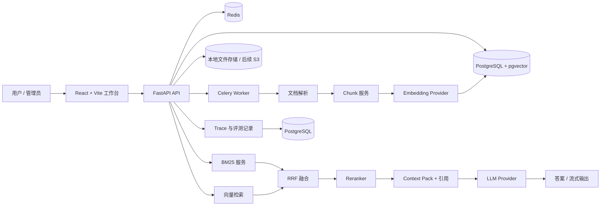

# PolicyRAG Studio 最终开发方案

> 项目定位：面向政务政策的可复现 RAG 检索实验平台  
> 核心目标：把文档切片、混合检索、Reranker、引用溯源和检索评测做成一条可运行、可对比、可解释的工程链路。  
> 项目原则：少堆框架，多做实验；页面围绕实验效率；不接触公司代码和敏感政务数据。

## 1. 项目信息

- **项目名**：PolicyRAG Studio
- **中文名**：政务政策切片与智能检索平台
- **目标岗位**：AI 应用开发工程师、RAG 开发工程师、Python 后端（AI 方向）
- **项目类型**：个人开源项目 / 求职作品集
- **建议周期**：6 周，每周 12～18 小时
- **后端与 AI**：Python 3.12、FastAPI、Pydantic、SQLAlchemy、PostgreSQL、pgvector、Redis、Celery、pytest
- **前端**：React、TypeScript、Vite、自定义 CSS design tokens、TanStack Query、React Router、Recharts
- **部署与测试**：Docker Compose、Nginx、Vitest、Testing Library、Playwright、GitHub Actions
- **数据来源**：公开政策文件、公开办事指南、自行编写的合成问题集
- **开源协议**：MIT

## 2. 项目要解决的问题

政务政策文档存在以下问题：

1. 政策数量多、版本多，用户很难快速找到适用条款。
2. 条款编号、专有名词和同义表达同时存在，单一向量检索召回不稳定。
3. 固定长度切片容易切断条款，导致检索结果缺少完整上下文。
4. 普通 RAG 项目只展示最终回答，无法解释问题来自解析、切片、召回还是重排。
5. 没有评测集，就无法证明某种检索策略真的更好。

本项目不做完整政务系统，而是聚焦一个可验证的问题：

> 如何把政策文档切成更适合检索的 Chunk，并用可量化的实验证明混合检索和重排的价值？

## 3. 项目边界

### MVP 必须完成

- PDF、DOCX、TXT、Markdown 文档上传与解析
- 固定长度、标题层级、递归三种 Chunk 策略
- Chunk 预览、编辑和重新索引
- Embedding 抽象层，至少支持一种本地或 OpenAI 兼容模型
- PostgreSQL + pgvector 向量存储
- BM25 关键词检索
- Dense + BM25 混合检索
- RRF 融合
- Reranker 重排
- Top-K、召回数量、重排数量可配置
- 检索结果引用来源和原文位置
- 简单答案生成和引用
- 检索 Trace
- 检索评测集和指标看板
- 响应式 React 管理工作台
- Docker Compose 一键启动
- 后端 pytest、前端 Vitest 和 Playwright 测试
- GitHub Actions

### MVP 暂不实现

- 多租户和复杂 RBAC
- 真实政务系统对接
- 完整 Agent 工作流
- 多模态 OCR
- 复杂多租户权限
- LangGraph 多步骤状态机
- 模型训练和微调
- 生产级高并发优化

### 后续扩展

- 查询改写
- 父子 Chunk
- 文档版本对比
- 权限过滤
- Dify 适配器
- AI 预审工具调用
- PDF 表格和扫描件解析
- 模型和 Prompt 的 A/B 发布

## 4. 核心竞争力

普通 RAG 项目通常是：

```text
上传 PDF -> 调用向量库 -> 拼接 Prompt -> 调用模型
```

本项目需要证明：

1. 你知道不同 Chunk 策略会如何影响检索。
2. 你知道纯向量检索在精确词匹配上的缺陷。
3. 你知道 BM25、RRF 和 Reranker 各自解决什么问题。
4. 你能用同一批问题评测不同策略，而不是凭感觉判断效果。
5. 你能定位检索失败来自解析、切片、召回、重排还是生成。
6. 你能把实验结果讲成清晰的工程决策。

## 5. 总体架构



### 服务职责

- **React 工作台**：文档管理、Chunk Lab、检索对比、评测看板、Trace 查看；通过 OpenAPI 类型安全地调用 FastAPI。
- **FastAPI**：业务 API、检索编排、鉴权扩展点、SSE 流式输出和 OpenAPI 文档。
- **Celery Worker**：文档解析、Chunk 生成、Embedding、批量评测。
- **PostgreSQL**：文档、Chunk、检索记录和评测结果。
- **pgvector**：Chunk 向量与相似度检索。
- **Redis**：Celery Broker、任务状态、缓存和幂等锁。
- **本地文件系统**：MVP 阶段保存上传文件，保留对象存储适配接口。

## 6. 技术选择与理由

### Python + FastAPI

- 异步接口适合 LLM 和流式输出。
- Pydantic 适合结构化请求、响应和模型输出校验。
- 面试中可以讲依赖注入、异步、SSE、异常处理和后台任务。

### PostgreSQL + pgvector

- 不额外引入 Milvus/Qdrant/Elasticsearch，降低部署复杂度。
- 业务数据和向量数据放在同一个数据库，便于事务和过滤。
- 可以实验 HNSW、IVFFlat、距离度量和过滤条件对性能的影响。

### BM25 + 向量混合检索

- 向量检索擅长语义相似。
- BM25 擅长政策编号、专有名词、精确条款匹配。
- 用 RRF 合并两路结果，避免手工调权重。

### Reranker

- 第一阶段召回追求覆盖率，第二阶段重排追求相关性。
- 只对 Top 20～50 个候选重排，控制延迟和成本。

### 不使用 LangChain 作为核心依赖

- 核心链路自己实现，便于理解、测试和面试解释。
- 模型 SDK、文档解析、向量检索均使用轻量接口。
- 后续可以增加 LangChain 或 Dify 适配器，但不作为主链路。

### React + TypeScript 工作台

- React + Vite 适合 FastAPI 前后端分离，不需要引入多余的 Node 服务端。
- TypeScript 让检索参数、候选结果、Chunk 和评测指标具备明确的数据契约。
- TanStack Query 管理请求缓存和异步状态，避免在组件中手写 loading/error 逻辑。
- React Router 承担页面路由，React Hook Form + Zod 处理 Chunk 编辑和检索配置。
- 使用 `openapi-typescript` 从 FastAPI OpenAPI 文档生成接口类型，减少前后端字段不一致。
- 视觉层使用自定义 CSS tokens 和轻量组件，避免做成通用后台模板。
- Playwright 覆盖上传文档、创建 Chunk、执行检索和查看评测四条端到端流程。

### 前端视觉方向

- **关键词**：研究工作台、证据链、实验台、数据密度、可信感。
- **布局**：左侧窄导航、顶部系统状态栏、主工作区三栏对比，不使用大面积渐变。
- **主色**：墨黑、冷灰、信号蓝；成功状态用青绿色，风险状态用琥珀色。
- **字号**：正文 13～14px，数据指标使用等宽字体，避免营销页式大标题。
- **卡片**：细边框、10～12px 圆角、低阴影，强调信息层级而不是装饰。
- **动效**：只用于加载、状态切换和 Trace 展开，不做无意义漂浮动画。
- **响应式**：桌面优先；移动端将三栏对比折叠为策略切换和单列结果。

## 7. 仓库结构

```text
policy-rag-studio/
├── README.md
├── LICENSE
├── .env.example
├── .gitignore
├── Makefile
├── docker-compose.yml
├── pyproject.toml
├── alembic.ini
├── app/
│   ├── main.py
│   ├── config.py
│   ├── api/
│   │   ├── deps.py
│   │   ├── routes_documents.py
│   │   ├── routes_chunks.py
│   │   ├── routes_retrieval.py
│   │   ├── routes_evaluation.py
│   │   └── routes_traces.py
│   ├── db/
│   │   ├── base.py
│   │   ├── session.py
│   │   ├── models.py
│   │   └── migrations/
│   ├── schemas/
│   ├── services/
│   │   ├── parsing/
│   │   ├── chunking/
│   │   ├── embedding/
│   │   ├── retrieval/
│   │   ├── reranking/
│   │   ├── generation/
│   │   ├── evaluation/
│   │   └── tracing/
│   ├── workers/
│   └── utils/
├── web/
│   ├── package.json
│   ├── vite.config.ts
│   ├── Dockerfile
│   ├── nginx.conf
│   ├── playwright.config.ts
│   └── src/
│       ├── main.tsx
│       ├── app/
│       │   ├── router.tsx
│       │   └── providers.tsx
│       ├── components/
│       │   ├── ui/
│       │   ├── layout/
│       │   └── data-display/
│       ├── features/
│       │   ├── documents/
│       │   ├── chunk-lab/
│       │   ├── retrieval/
│       │   ├── evaluation/
│       │   └── traces/
│       ├── lib/
│       │   ├── api-client.ts
│       │   ├── query-client.ts
│       │   └── formatters.ts
│       ├── styles/
│       └── types/
│           └── openapi.d.ts
├── data/
│   ├── samples/
│   └── eval/
├── tests/
│   ├── unit/
│   └── integration/
├── docs/
│   ├── architecture.md
│   ├── experiments/
│   └── interview-notes.md
└── scripts/
    ├── seed.py
    ├── run_eval.py
    └── rebuild_index.py
```

## 8. 核心数据模型

### documents

- id
- title
- source
- department
- effective_date
- status
- created_at
- updated_at

### document_versions

- id
- document_id
- version_no
- file_name
- storage_path
- checksum
- parse_status
- created_at

### chunk_profiles

- id
- name
- strategy
- parameters JSONB
- created_at

### chunks

- id
- document_version_id
- chunk_profile_id
- page_no
- heading_path
- content
- token_count
- metadata JSONB
- embedding vector(1024)
- checksum
- created_at

### retrieval_runs

- id
- request_id
- query
- strategy
- config JSONB
- latency_ms
- top_k
- created_at

### retrieval_steps

- id
- retrieval_run_id
- stage
- input_count
- output_count
- latency_ms
- details JSONB

### evaluation_runs

- id
- dataset_name
- strategy
- config JSONB
- metrics JSONB
- created_at

### evaluation_cases

- id
- evaluation_run_id
- query
- relevant_chunk_ids JSONB
- retrieved_chunk_ids JSONB
- metrics JSONB
- failure_type

## 9. Chunk 策略设计

定义统一接口：

```python
class Chunker(Protocol):
    def split(self, document: ParsedDocument, config: ChunkConfig) -> list[ChunkDraft]:
        ...
```

### 固定长度

- 按 token 数切片
- 支持 overlap
- 作为基线策略

### 标题层级

- 识别标题和条款层级
- 保持条款完整性
- 保留 heading_path

### 递归切片

- 优先按段落、句子、字符递归切分
- 减少语义被截断

### 后续：父子 Chunk

- 子 Chunk 用于召回
- 父 Chunk 用于上下文补全
- 重点对比 Recall 和上下文完整度

## 10. 检索链路

### 基线 1：Dense Retrieval

```text
query -> embedding -> pgvector cosine search -> top_k
```

### 基线 2：BM25

```text
query -> 中文分词 -> BM25 -> top_k
```

### 方案 3：Hybrid + RRF

```text
query
  -> dense top_k
  -> bm25 top_k
  -> RRF fusion
  -> candidate top_k
```

RRF 公式：

```text
score(d) = sum(1 / (k + rank_i(d)))
```

默认 `k = 60`，允许在实验中调整。

### 方案 4：Hybrid + Reranker

```text
hybrid candidates top_n
  -> cross-encoder reranker
  -> final top_k
  -> context pack
```

默认只重排 Top 30，避免全量重排导致延迟过高。

## 11. 评测设计

### 评测数据格式

```jsonl
{"query":"申请个体工商户登记需要哪些材料？","relevant_chunk_ids":["chunk_001","chunk_018"],"tags":["materials"]}
```

### 评测集要求

- 至少 50 条问题
- 问题覆盖政策名称、条款编号、材料清单、办理条件和同义表达
- 明确标注相关 Chunk
- 训练调参问题与最终测试问题分开
- 评测数据放入仓库，敏感数据不得提交

### 指标

- Recall@1
- Recall@3
- Recall@5
- MRR
- nDCG@5
- P50 / P95 检索延迟
- 平均候选数量
- Reranker 增加的延迟
- 答案引用覆盖率

### 对比实验

固定同一批文档和问题，至少比较：

1. 固定长度 + Dense
2. 标题切片 + Dense
3. 标题切片 + BM25
4. 标题切片 + Hybrid
5. 标题切片 + Hybrid + Reranker

最终输出：

- `docs/experiments/chunking.md`
- `docs/experiments/hybrid-search.md`
- `docs/experiments/reranker.md`
- `docs/experiments/evaluation-summary.md`

每份实验文档必须包含：

- 假设
- 基线
- 配置
- 评测集
- 指标
- 失败案例
- 最终决策
- 代价和风险

## 12. API 设计

### 文档与 Chunk

- `POST /api/v1/documents`：上传文档
- `GET /api/v1/documents`：文档列表
- `POST /api/v1/documents/{id}/parse`：触发解析
- `GET /api/v1/documents/{id}/chunks`：查看 Chunk
- `PATCH /api/v1/chunks/{id}`：编辑 Chunk
- `POST /api/v1/documents/{id}/index`：重建索引

### 检索

- `POST /api/v1/retrieval/search`：执行检索
- `POST /api/v1/retrieval/compare`：并行比较多种策略
- `POST /api/v1/answer/stream`：流式生成带引用答案
- `GET /api/v1/traces/{request_id}`：查看检索 Trace

### 评测

- `POST /api/v1/evaluations/run`：运行评测
- `GET /api/v1/evaluations/{id}`：查看结果
- `GET /api/v1/evaluations`：历史评测列表

## 13. 前端页面与交互

### 文档管理

- 拖拽上传文档，显示解析进度和错误原因
- 表格展示解析状态、Chunk 数、策略和索引状态
- 文档详情抽屉展示来源、版本和元数据
- 触发重新解析、重建索引和删除文档

### 总览

- 展示 PostgreSQL、pgvector、Redis 和模型服务状态
- 展示最近检索、最近评测和异常任务
- 展示当前知识库规模、Chunk 数和平均检索延迟

### Chunk Lab

- 左侧选择文档，中间显示 Chunk 列表，右侧显示原文和编辑器
- 调整 chunk size、overlap、标题策略等参数
- 预览切片边界，高亮被截断的条款
- 编辑 Chunk 文本和元数据
- 一键重建索引并显示进度
- 底部对比不同策略的 Chunk 数量、平均长度和检索指标

### 检索对比

- 输入同一个问题，同时运行 Dense、BM25、Hybrid、Hybrid + Rerank
- 使用三栏或四栏并排工作区，而不是把结果堆在一个列表里
- 展示分数、来源、页码、原文片段和阶段耗时
- 高亮多个策略共同命中的 Chunk，便于判断结果稳定性
- 支持人工标记相关/不相关，并写入评测反馈
- 可展开 RRF 排名变化和 Reranker 前后对比

### 评测看板

- 选择评测集和策略组合
- 展示 Recall@K、MRR、nDCG、P95 延迟和成本
- 使用柱状图、折线图和表格联动展示
- 点击指标下钻到具体失败问题
- 按解析、切片、召回、重排、生成分类失败原因

### Trace 详情

- 使用时间线展示一次检索的完整阶段
- 原始查询、查询改写和过滤条件
- Dense 候选、BM25 候选与 RRF 排名变化
- Reranker 前后排名和分数变化
- 最终 Context Pack、引用和答案
- Token、耗时、模型和错误信息

## 14. 开发里程碑

### 第 1 周：项目骨架与文档入库

目标：上传文档后能看到可检索内容。

- 初始化仓库和 Docker Compose
- FastAPI 项目结构
- React + Vite 工作台骨架和路由
- PostgreSQL + pgvector
- 文档上传和解析
- 基础 Chunk 入库
- React 文档管理页面和上传流程
- 第一个单元测试

验收：

- 能上传 3 份政策文档
- 能看到解析后的 Chunk
- 数据库中有向量记录

### 第 2 周：Chunk Lab

目标：能对比不同 Chunk 策略。

- 固定长度、标题层级、递归切片
- Chunk 预览与编辑
- 重建索引
- Chunk 统计
- Chunk 策略参数保存

验收：

- 同一文档可用三种策略生成 Chunk
- 能查看数量、平均长度和边界
- 有初步对比记录

### 第 3 周：混合检索

目标：完成 Dense、BM25、Hybrid 三条检索路径。

- Embedding Provider
- Dense 检索
- BM25 索引
- RRF 融合
- 检索 API
- React 检索对比工作区

验收：

- 同一问题能并排比较三种策略
- 每个结果都有来源和页码
- 记录每次检索的中间结果

### 第 4 周：Reranker 与答案生成

目标：完成完整问答闭环。

- Reranker Provider
- Top-N 重排
- Context Pack 构造
- 带引用答案生成
- SSE 流式输出
- 检索 Trace
- 异常和超时处理

验收：

- 用户可提问并获得带引用回答
- Trace 能展示完整检索链路
- Reranker 无模型时能降级关闭

### 第 5 周：评测与实验报告

目标：用数据证明方案有效。

- 评测集 JSONL
- 指标计算
- 批量评测
- 策略对比实验
- 失败案例分析
- React 评测看板与指标图表

验收：

- 至少跑完四种策略对比
- 输出 Markdown 实验报告
- 报告包含真实指标和失败案例

### 第 6 周：工程化交付

目标：让别人可以一键运行和理解项目。

- Redis + Celery 异步任务
- 任务重试和幂等
- Docker Compose 健康检查（API、Worker、Web、Postgres、Redis）
- Vitest、Playwright 和 GitHub Actions
- README
- 架构图
- 3 分钟演示视频
- v0.1.0 Release

验收：

- 新机器可按照 README 启动
- CI 通过
- 演示流程可复现
- 有一个完整实验报告

## 15. 测试策略

### 单元测试

- Chunk 数量与边界
- RRF 排序
- Recall、MRR、nDCG 计算
- Pydantic Schema 校验
- Trace 数据结构

### 集成测试

- 文档上传到索引
- Dense 检索
- BM25 检索
- Hybrid 检索
- 评测任务执行

### 异常测试

- 空文档
- 超长文档
- 损坏 PDF
- 模型接口超时
- Embedding 维度不匹配
- Redis 任务重复消费
- Reranker 服务不可用

## 16. 可观测性

每个检索请求生成 `request_id`，记录：

- 查询文本
- 使用的 Chunk 策略
- 检索参数
- 各阶段候选数量
- 各阶段耗时
- 最终结果
- 模型名称
- Token 和成本
- 异常信息

MVP 先写入 PostgreSQL，后续可选接入 Langfuse、OpenTelemetry 或 Prometheus。

## 17. 安全与合规

- 只使用公开政策文件和合成数据
- 不提交公司内部代码、数据库和真实办件数据
- `.env` 不入库
- 上传文件和日志不得包含身份证号、手机号等敏感信息
- LLM 调用前允许开启脱敏
- README 中明确项目为个人作品，不代表任何政府机构

## 18. GitHub 发布清单

- [ ] README 有项目定位、截图、架构图和启动方式
- [ ] MIT LICENSE
- [ ] `.env.example`
- [ ] Docker Compose 一键启动
- [ ] 样例文档和评测集
- [ ] 4 种检索策略对比结果
- [ ] 实验报告
- [ ] 后端单元测试和集成测试
- [ ] 前端 Vitest 和 Playwright 测试
- [ ] GitHub Actions
- [ ] 架构图
- [ ] 3 分钟演示视频
- [ ] v0.1.0 Release
- [ ] 项目边界和后续规划

## 19. README 结构

```markdown
# PolicyRAG Studio

政务政策切片与可评测检索平台。

## Why
普通 RAG 为什么不够，项目解决了什么问题。

## Features
文档解析、Chunk Lab、Hybrid Search、Reranker、评测、Trace。

## Architecture
架构图。

## Quick Start
docker compose up

## Frontend
React research workbench for Chunk Lab, strategy comparison and evaluation.

## Experiment Results
不同策略的 Recall@5、MRR、延迟对比。

## Project Structure
目录说明。

## Design Decisions
为什么用 pgvector、为什么自己实现 RRF、为什么只重排 Top 30。

## Limitations
当前适用范围和未实现能力。

## Roadmap
查询改写、父子 Chunk、权限过滤、AI 预审。
```

## 20. 面试讲述模板

```text
我做的不是普通知识库问答，而是一个可复现的政策检索实验平台。

项目先支持多格式政策文档解析和 Chunk 管理，再比较固定切片、标题切片和递归切片对召回的影响。
检索层实现了 Dense、BM25 和 Hybrid，使用 RRF 融合两路结果，并支持 Reranker 重排。

为了证明效果，我构建了 50 条以上政策评测问题，统一比较 Recall@5、MRR、nDCG 和 P95 延迟。
最终我不只展示最终答案，还能通过 Trace 看到问题出在解析、切片、召回还是重排。
```

## 21. 简历项目描述模板

> **PolicyRAG Studio｜政务政策切片与可评测检索平台**  
> 技术栈：Python、FastAPI、PostgreSQL、pgvector、Redis、Celery、React、TypeScript、Docker
>
> - 设计多格式政策文档入库与 Chunk Lab，支持固定长度、标题层级和递归切片，并可预览、编辑和重建索引。
> - 实现 Dense、BM25 和 Hybrid 检索，使用 RRF 融合候选结果，并通过可配置 Reranker 优化最终 Top-K。
> - 构建检索评测集与 Trace 体系，对比不同 Chunk 和召回策略的 Recall@5、MRR、nDCG 与延迟，定位检索失败原因。
> - 使用 FastAPI、PostgreSQL/pgvector、Redis/Celery 和 Docker Compose 完成异步索引、异常处理、测试和部署。

## 22. 项目风险与控制

| 风险 | 控制方式 |
|---|---|
| 范围过大 | MVP 只做 Chunk Lab + 检索 + 评测 |
| 本地模型太重 | 抽象 Embedding / Reranker Provider，支持 API 和本地两种实现 |
| 评测数据难找 | 先用公开政策和合成问题，逐步补充 |
| 指标造假风险 | 所有指标由脚本自动计算并保存原始结果 |
| Agent 分散精力 | MVP 不实现 Agent，后续作为扩展 |
| 前端范围失控 | 使用 React + Vite + Radix/shadcn，只做 6 个核心页面；不做复杂设计系统 |
| 中文 BM25 效果差 | 使用 jieba 分词，并在实验报告中说明边界 |
| 面试讲不清 | 每个模块配一篇设计决策和失败案例 |

## 23. 第一组 GitHub Issues

1. 初始化 FastAPI、PostgreSQL 和 Docker Compose
2. 实现 PDF、DOCX、TXT、Markdown 解析
3. 实现固定长度 Chunker
4. 实现标题层级 Chunker
5. 实现递归 Chunker
6. 初始化 React + Vite 工作台与 API 类型生成
7. 完成 Chunk Lab 页面
8. 实现 Embedding Provider 接口
9. 建立 pgvector 索引和 Dense 检索
10. 实现 BM25 检索
11. 实现 RRF 融合
12. 实现 Reranker Provider
13. 实现检索对比 API 和 React 对比工作区
14. 构建评测集、指标计算和评测看板
15. 实现 Trace API、时间线详情和失败分类
16. 完成 Docker、Vitest、Playwright、README 和 Release

## 24. 最终验收标准

项目完成后，必须能演示以下流程：

```text
上传政策文件
-> 选择 Chunk 策略
-> 查看和编辑 Chunk
-> 建立向量索引
-> 输入政策问题
-> 对比 Dense、BM25、Hybrid、Hybrid + Rerank
-> 查看引用原文
-> 查看 Trace
-> 运行评测集
-> 展示真实指标和失败案例
```

如果只能展示“输入问题，模型回答”，项目还不算完成。
