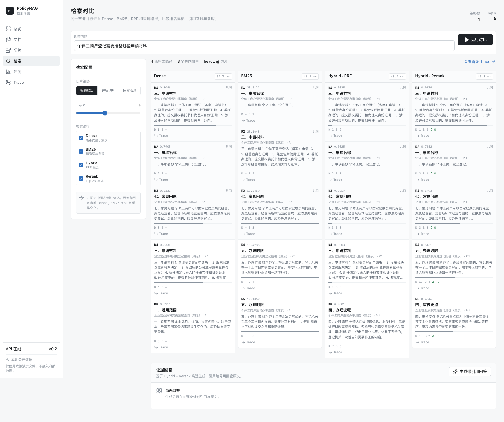
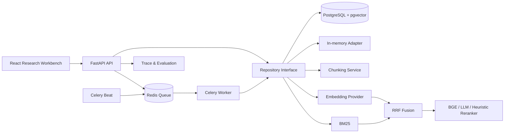
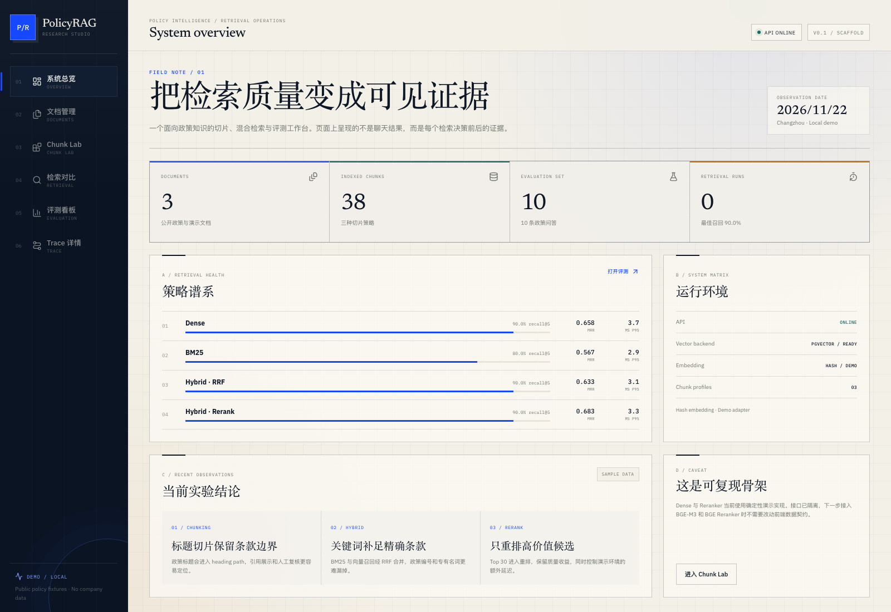

# PolicyRAG Studio

> 政务政策切片与可评测检索平台  
> A reproducible retrieval workbench for chunking, hybrid search, reranking and evaluation.

不是“上传后聊两句”的 Demo，而是把解析、切片、召回、重排、引用和失败原因做成可复核证据的工作台。

## 核心指标

以下数据来自固定测试集的真实模型运行，不是界面演示值：

| 指标 | 结果 | 说明 |
| --- | ---: | --- |
| 检索 Recall@5 | 94.74% → **100.00%** | 纯 RRF → BGE Reranker |
| 检索 MRR | 0.6412 → **0.7833** | 正确条款平均排名前移 |
| 检索 nDCG@5 | 0.7189 → **0.8372** | 排序质量提升 |
| 引用召回率 | 100.00% | 38 / 38 条回答引用到标注条款 |
| 引用精确率 | 33.99% | 采纳严格口径，暴露“过度引用”问题 |
| 无效引用率 | 0.00% | 回答中的引用编号均存在 |
| LLM 裁判通过率 | 100.00% | 同模型裁判，20 条人工复核待完成 |
| 回答平均耗时 / Token | 9.23 s / 1659 | qwen embedding + BGE + GLM，本地网络实测 |

评测集为 152 条合成政策问题（开发集 114 / 测试集 38）。完整原始数据、失败样本和限制说明：[检索重排报告](docs/experiments/20261122-real-embedding-reranker-test.md) · [回答质量报告](docs/experiments/20261122-answer-quality-test.md)。

快速体验：`docker compose up --build` → [http://localhost:8080](http://localhost:8080)。架构链路：React 工作台 → FastAPI → PostgreSQL/pgvector + Redis/Celery → Hybrid Retrieval → Rerank → 带引用回答，[查看完整图示](#架构)。

## 为什么做这个项目

普通 RAG Demo 通常只展示“上传文档 → 问答”的结果，很难回答下面这些问题：

- 不同 Chunk 策略对召回有什么影响？
- 为什么向量检索之外还需要 BM25？
- RRF 融合后，正确条款的排名有没有变化？
- Reranker 带来的质量收益是否值得额外延迟？
- 问题到底出在解析、切片、召回、重排还是生成？

PolicyRAG Studio 把这些问题做成一个可运行、可对比、可量化的检索工作台。项目不追求“堆更多框架”，而是围绕以下闭环：

```text
文档解析 → Chunk Lab → Dense / BM25 → RRF → Rerank → 引用 → Trace → 评测
```

## 当前状态

这是一个 **可运行的 v0.2.0 版本**：

- FastAPI 后端提供文档、Chunk、检索、Trace 和评测 API
- React + TypeScript 研究工作台包含 6 个核心页面
- 内置 3 份演示政策，支持固定长度、标题层级、递归三种切片
- 实现 BM25、可配置 Embedding Provider、RRF 融合，以及启发式、LLM、本地 BGE 重排
- 检索工作台可生成带编号引用的回答，并可直接查看对应 Trace
- 评测看板实时计算检索指标；离线脚本补充引用质量、LLM 裁判和人工复核工作表
- PostgreSQL 持久化文档、Chunk、Trace 和 Chunk 向量；内存适配器用于测试与离线演示
- Redis + Celery Worker 异步执行解析、切片、Embedding 与索引，支持进度、失败重试、取消和 stale-task 恢复
- Docker Compose 已配置 PostgreSQL/pgvector、Redis、API、Worker、Beat 和 Web

> 注意：默认 `EMBEDDING_PROVIDER=hash` 使用确定性演示向量；可切换为本地 BGE-M3 或 OpenAI 兼容 Embeddings API。Reranker 支持 none、启发式、LLM 和本地 BGE。Dense 检索使用 pgvector 余弦距离，Schema 由 Alembic 管理。

## 核心页面

### 系统总览

展示文档数、Chunk 数、评测集规模、四类检索策略的质量与延迟。

### 文档管理

上传 PDF、DOCX、TXT、Markdown，查看解析状态、部门、生效日期和 Chunk 数量。

### Chunk Lab

同一份政策可以在固定长度、标题层级和递归切片之间切换；支持查看 Chunk 边界、编辑内容并保存。

### 检索对比

同一个问题并行运行 Dense、BM25、Hybrid RRF 和 Hybrid Rerank，并排显示：

- Top-K 结果
- 共同命中 Chunk
- Dense / BM25 排名
- Rerank 排名变化
- 引用来源和执行耗时
- 基于 Rerank Top-K 生成带编号引用的回答，并可回看原文



### 评测看板

使用固定评测集计算 Recall@5、MRR、nDCG@5 和 P95 延迟，展示失败分类。

### Trace 详情

按阶段查看查询解析、Dense 召回、BM25 召回、RRF 融合、重排和 Context Pack。

## 架构



默认 `STORE_BACKEND=postgres`。上传接口只创建文档和 `queued` 任务，Worker 按 `parsing → chunking → embedding → ready` 推进。Beat 每 15 秒扫描 stale processing 任务并重新投递；失败任务带错误码和错误信息，可取消或重试。Dense 查询从 `chunk_embeddings` 读取 pgvector 向量并按余弦距离排序。



## Embedding Provider 配置

默认配置无需模型即可启动：

```bash
EMBEDDING_PROVIDER=hash
```

本地 BGE-M3：

```bash
uv sync --extra local
EMBEDDING_PROVIDER=bge
BGE_EMBEDDING_MODEL=BAAI/bge-m3
```

OpenAI 兼容 Embeddings API：

```bash
EMBEDDING_PROVIDER=openai
EMBEDDING_API_BASE=https://your-endpoint/v1
EMBEDDING_API_KEY=your-key
OPENAI_EMBEDDING_MODEL=qwen3.7-text-embedding-flash
EMBEDDING_DIMENSIONS=1024
EMBEDDING_BATCH_SIZE=16
```

文本模型使用同一个 OpenAI 兼容协议；本地无需鉴权的服务可以不填 `LLM_API_KEY`：

```bash
LLM_API_BASE=https://your-endpoint/v1
LLM_API_KEY=your-key
LLM_MODEL=glm-5.3-flash
```

`POST /api/v1/answer` 会把 Hybrid + Rerank 检索结果组装成带编号引用的上下文，再调用文本模型生成回答。`POST /api/v1/answer/stream` 使用同一套 Context Pack，通过 SSE 增量输出，并返回首字延迟、总耗时、Token usage、Grounding 状态和无效引用编号；生成阶段会写回 Trace。

Provider 会对相同文本做进程内缓存；批量文档向量化会尽量合并为一次批处理请求。

## Reranker 配置与实验

默认使用可复现的启发式 Reranker：

```bash
RERANKER_PROVIDER=heuristic
```

可选真实 Reranker：

```bash
# OpenAI 兼容 Chat 接口作为 listwise reranker
RERANKER_PROVIDER=llm
RERANKER_MODEL=glm-5.3-flash
RERANKER_TIMEOUT_SECONDS=30

# 本地 CrossEncoder；需要 uv sync --extra local
RERANKER_PROVIDER=bge
BGE_RERANKER_MODEL=BAAI/bge-reranker-base
```

评测集包含 152 条合成政策问题，其中开发集 114 条、测试集 38 条。标签固定到真实 Chunk 标题，生成规则见 `data/eval/README.md`。

统一重排实验命令（测试集使用真实 qwen embedding）：

```bash
uv run python -m app.experiments.reranker_benchmark \
  --providers none,heuristic,bge \
  --dataset policy-synthetic-v1 \
  --split test \
  --output docs/experiments/20261122-real-embedding-reranker-test.md
```

当前 38 条测试集上（`qwen3.7-text-embedding-flash` 真实向量）：

| Provider | Recall@5 | MRR | nDCG@5 | Rerank P95 | Fallbacks |
| --- | ---: | ---: | ---: | ---: | ---: |
| Pure RRF | 0.9474 | 0.6412 | 0.7189 | 0.0 ms | 0 |
| Heuristic | 0.9474 | 0.6447 | 0.7203 | 0.4 ms | 0 |
| BGE Base | **1.0000** | **0.7833** | **0.8372** | 113.8 ms | 0 |

完整报告见 [`docs/experiments/20261122-real-embedding-reranker-test.md`](docs/experiments/20261122-real-embedding-reranker-test.md)。BGE Reranker 将 MRR 从纯 RRF 的 `0.6412` 提升到 `0.7833`，并消除两个 Top-5 漏召回；代价是 Rerank P95 增加约 `114 ms`。本地模型的 API 费用为 0，CPU 计算和电力成本尚未货币化。

LLM Reranker 的实测仍受到上游 `429` 限流，报告已标记为无效，不作为效果结论。

## 回答质量评测

回答质量脚本直接走生产回答链路：`Hybrid + Rerank → Context Pack → LLM → citation guard`，并输出 Markdown 报告、逐题 JSON 原始结果和 20 条人工复核工作表。

```bash
RERANKER_PROVIDER=bge BGE_RERANKER_MODEL=BAAI/bge-reranker-base \
uv run python -m app.experiments.answer_quality \
  --dataset policy-synthetic-v1 \
  --split test \
  --concurrency 2 \
  --output docs/experiments/20261122-answer-quality-test.md \
  --review-size 20
```

评测包含四类信号：

- **引用精确率**：有效引用中，命中标注文档与标题的比例。
- **引用召回率**：每题是否至少引用到一个标注来源。
- **Grounding 状态**：生产链路自己的引用合法性校验。
- **LLM 裁判**：按 faithfulness、relevance、completeness 打 1–5 分，并列出无证据结论。

当前 38 条测试集在 BGE Reranker 零降级配置下结果为引用召回 `100%`、引用精确 `33.99%`、无效引用 `0%`。召回与精确的差异说明模型通常能找到正确证据，但会同时引用多个相关片段，造成严格口径下的过度引用；这不能仅靠“引用编号合法”解释，因此报告保留逐题原文、引用证据和人工复核入口。裁判与回答使用同一模型，结论必须结合人工复核阅读。

相关文件：

- [评测报告](docs/experiments/20261122-answer-quality-test.md)
- [原始 JSON](docs/experiments/20261122-answer-quality-test.json)
- [人工复核工作表](docs/experiments/20261122-answer-quality-test-review.md)

## 技术栈

**后端**

- Python 3.12
- FastAPI / Pydantic
- pytest / Ruff
- PostgreSQL + pgvector（容器已配置）
- Redis + Celery（异步索引、重试、取消与 stale-task 恢复）

**前端**

- React 19 + TypeScript + Vite
- React Router
- TanStack Query
- Recharts
- 自定义 CSS design tokens
- Vitest / Testing Library / Playwright

## 快速开始

### 本地开发

需要 Python 3.12、uv、Node.js 22+ 和 pnpm。

```bash
uv sync
docker compose up -d db redis
uv run alembic upgrade head
uv run uvicorn app.main:app --reload --port 8000
```

`EMBEDDING_DIMENSIONS` 必须与当前 Provider 的输出维度一致。初始迁移使用 `vector(1024)`；切换维度时需要新增迁移并重建向量。

另开 Worker 与 Beat 终端：

```bash
uv run celery -A app.workers.celery_app:celery_app worker --loglevel=INFO --concurrency=1
uv run celery -A app.workers.celery_app:celery_app beat --loglevel=INFO
```

前端开发另开一个终端：

```bash
cd web
pnpm install
pnpm dev
```

打开：

- 工作台：<http://localhost:5173>
- API 文档：<http://localhost:8000/docs>

### Docker Compose

```bash
docker compose up --build
```

打开：

- 工作台：<http://localhost:8080>
- API 文档：<http://localhost:8000/docs>

## 测试与检查

```bash
# 后端（默认使用内存适配器）
uv run ruff check app tests
uv run pytest

# PostgreSQL Repository 契约测试（使用独立数据库，避免污染开发数据）
make test-postgres

# Schema 迁移
make migrate

# 前端
cd web
pnpm lint
pnpm test
pnpm build
```

Playwright 冒烟测试：

```bash
cd web
pnpm exec playwright install chromium
pnpm test:e2e
```

`pnpm test:e2e` 需要前端和 API 已经启动。

## API 一览

| 方法 | 路径 | 说明 |
|---|---|---|
| GET | `/api/v1/health` | 服务状态 |
| GET | `/api/v1/overview` | 总览和最新评测 |
| GET | `/api/v1/documents` | 文档列表 |
| POST | `/api/v1/documents` | 上传文档并创建异步索引任务 |
| GET | `/api/v1/documents/{id}/chunks` | 查看指定策略的 Chunk |
| PATCH | `/api/v1/chunks/{id}` | 修改 Chunk |
| POST | `/api/v1/retrieval/compare` | 并行比较检索策略 |
| GET | `/api/v1/traces/{id}` | 查看执行 Trace |
| POST | `/api/v1/answer` | 基于检索结果生成带引用回答 |
| POST | `/api/v1/answer/stream` | SSE 流式回答与引用校验 |
| GET | `/api/v1/evaluations/summary` | 计算评测指标 |

## 设计决策

### 为什么使用 BM25 + 向量

政策编号、条款名称和专有名词需要精确匹配，向量检索擅长语义相似。两路召回通过 RRF 融合，避免手工调整权重。

### 为什么只重排 Top 30

Reranker 的收益来自候选质量，但全量重排会增加延迟。默认只重排融合后的前 30 个候选。

### 为什么当前不接入 LangChain

核心链路直接实现，便于测试、调试和面试解释。后续可以把检索组件包装成适配器，而不是让框架隐藏执行细节。

### 为什么前后端分离

FastAPI 负责稳定的数据契约和算法编排，React 负责高密度比较工作区。前端通过 OpenAPI/类型定义对接，后续可以替换模型实现而不改交互层。

## 官方办事指南导入

首批官方语料来自江苏政务服务网常州法人服务事项，来源目录、事项编码和使用边界见
[`data/sources/jszwfw/README.md`](data/sources/jszwfw/README.md)。

```bash
uv run python -m app.experiments.import_official_guides
```

命令会下载官方指南 PDF 和可下载的申请表格，生成：

- `data/official/jszwfw-guides.v1.jsonl`：规范化 RAG 语料
- `data/official/jszwfw-guides.v1.manifest.json`：来源 URL、文件名、大小和 SHA-256
- `data/official/raw/jszwfw/`：官方原始 PDF、DOCX 和示例图片

首批事项包括“公司变更登记注册（设区的市级权限）”和“用人单位公益性岗位补贴和社保补贴申领”。
导入过程不访问登录后的个人数据，也不在全站范围内爬取。

## 数据与合规

- 仓库只使用公开政策、办事指南和合成问题
- 不包含公司内部代码、数据库或真实办件数据
- 上传文件、日志和评测数据不得包含身份证号、手机号等敏感信息
- 项目为个人作品，不代表任何政府机构

## Roadmap

当前开发按 [Development Roadmap](docs/development-roadmap.md) 推进：

- [x] M0：PostgreSQL + pgvector 持久化
- [x] M1：Redis + Celery 异步索引
- [x] M2：真实 Reranker 与可信评测
- [x] M3：流式回答与引用校验
- [x] M4：CI、E2E、监控与发布
- [ ] M5：回答质量人工复核、公网 Demo 与查询规划

`PROJECT_PLAN.md` 保留为项目设计方案；实际执行顺序、验收标准和当前状态以开发路线图为准。

## 演示与发布

- GitHub Release：[v0.2.0](https://github.com/quanzhan-zzz/policy-rag-studio/releases/tag/v0.2.0)
- 3 分钟演示脚本：[docs/demo-script.md](docs/demo-script.md)
- v0.2.0 发布说明：[docs/releases/v0.2.0.md](docs/releases/v0.2.0.md)
- CI 覆盖后端、前端、PostgreSQL 契约和 5 条 Playwright 用户路径

## License

MIT
