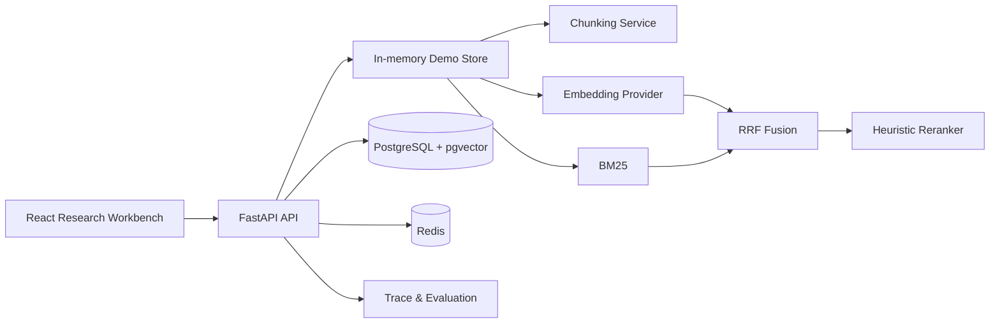

# PolicyRAG Studio

> 政务政策切片与可评测检索平台  
> A reproducible retrieval workbench for chunking, hybrid search, reranking and evaluation.


## 为什么做这个项目

普通 RAG Demo 通常只展示“上传文档 → 问答”的结果，很难回答下面这些问题：

- 不同 Chunk 策略对召回有什么影响？
- 为什么向量检索之外还需要 BM25？
- RRF 融合后，正确条款的排名有没有变化？
- Reranker 带来的质量收益是否值得额外延迟？
- 问题到底出在解析、切片、召回、重排还是生成？

PolicyRAG Studio 把这些问题做成一个可运行、可对比、可量化的检索工作台。项目不追求“堆更多框架”，而是围绕以下闭环：

```text
文档解析 → Chunk Lab → Dense / BM25 → RRF → Rerank → 引用 → Trace → 评测
```

## 当前状态

这是一个 **可运行的 v0.1 骨架**：

- FastAPI 后端提供文档、Chunk、检索、Trace 和评测 API
- React + TypeScript 研究工作台包含 6 个核心页面
- 内置 3 份演示政策，支持固定长度、标题层级、递归三种切片
- 实现 BM25、可配置 Embedding Provider、RRF 融合和启发式重排
- 检索工作台可生成带编号引用的回答，并可直接查看对应 Trace
- 评测指标由后端在固定演示集上实时计算
- Docker Compose 已配置 PostgreSQL/pgvector、Redis、API 和 Web

> 注意：默认 `EMBEDDING_PROVIDER=hash` 使用确定性演示向量，保证克隆后无需模型即可运行；可切换为本地 BGE-M3 或 OpenAI 兼容 Embeddings API。Reranker 目前仍是启发式实现。上传文档当前保存在进程内，重启后重置。

## 核心页面

### 系统总览

展示文档数、Chunk 数、评测集规模、四类检索策略的质量与延迟。

### 文档管理

上传 PDF、DOCX、TXT、Markdown，查看解析状态、部门、生效日期和 Chunk 数量。

### Chunk Lab

同一份政策可以在固定长度、标题层级和递归切片之间切换；支持查看 Chunk 边界、编辑内容并保存。

### 检索对比

同一个问题并行运行 Dense、BM25、Hybrid RRF 和 Hybrid Rerank，并排显示：

- Top-K 结果
- 共同命中 Chunk
- Dense / BM25 排名
- Rerank 排名变化
- 引用来源和执行耗时
- 基于 Rerank Top-K 生成带编号引用的回答，并可回看原文

### 评测看板

使用固定评测集计算 Recall@5、MRR、nDCG@5 和 P95 延迟，展示失败分类。

### Trace 详情

按阶段查看查询解析、Dense 召回、BM25 召回、RRF 融合、重排和 Context Pack。

## 架构



当前数据库容器已经就绪，但 API 默认使用内存存储以保证克隆后即可运行。持久化仓储是下一步工作。

## Embedding Provider 配置

默认配置无需模型即可启动：

```bash
EMBEDDING_PROVIDER=hash
```

本地 BGE-M3：

```bash
uv sync --extra local
EMBEDDING_PROVIDER=bge
BGE_EMBEDDING_MODEL=BAAI/bge-m3
```

OpenAI 兼容 Embeddings API：

```bash
EMBEDDING_PROVIDER=openai
EMBEDDING_API_BASE=https://your-endpoint/v1
EMBEDDING_API_KEY=your-key
OPENAI_EMBEDDING_MODEL=qwen3.7-text-embedding-flash
```

文本模型使用同一个 OpenAI 兼容协议；本地无需鉴权的服务可以不填 `LLM_API_KEY`：

```bash
LLM_API_BASE=https://your-endpoint/v1
LLM_API_KEY=your-key
LLM_MODEL=glm-5.3-flash
```

`POST /api/v1/answer` 会把 Hybrid + Rerank 检索结果组装成带编号引用的上下文，再调用文本模型生成回答。

Provider 会对相同文本做进程内缓存；批量文档向量化会尽量合并为一次批处理请求。

## 技术栈

**后端**

- Python 3.12
- FastAPI / Pydantic
- pytest / Ruff
- PostgreSQL + pgvector（容器已配置）
- Redis + Celery（容器已配置，异步索引待接入）

**前端**

- React 19 + TypeScript + Vite
- React Router
- TanStack Query
- Recharts
- 自定义 CSS design tokens
- Vitest / Testing Library / Playwright

## 快速开始

### 本地开发

需要 Python 3.12、uv、Node.js 22+ 和 pnpm。

```bash
uv sync
uv run uvicorn app.main:app --reload --port 8000
```

另开一个终端：

```bash
cd web
pnpm install
pnpm dev
```

打开：

- 工作台：<http://localhost:5173>
- API 文档：<http://localhost:8000/docs>

### Docker Compose

```bash
docker compose up --build
```

打开：

- 工作台：<http://localhost:8080>
- API 文档：<http://localhost:8000/docs>

## 测试与检查

```bash
# 后端
uv run ruff check app tests
uv run pytest

# 前端
cd web
pnpm lint
pnpm test
pnpm build
```

Playwright 冒烟测试：

```bash
cd web
pnpm exec playwright install chromium
pnpm test:e2e
```

`pnpm test:e2e` 需要前端和 API 已经启动。

## API 一览

| 方法 | 路径 | 说明 |
|---|---|---|
| GET | `/api/v1/health` | 服务状态 |
| GET | `/api/v1/overview` | 总览和最新评测 |
| GET | `/api/v1/documents` | 文档列表 |
| POST | `/api/v1/documents` | 上传文档 |
| GET | `/api/v1/documents/{id}/chunks` | 查看指定策略的 Chunk |
| PATCH | `/api/v1/chunks/{id}` | 修改 Chunk |
| POST | `/api/v1/retrieval/compare` | 并行比较检索策略 |
| GET | `/api/v1/traces/{id}` | 查看执行 Trace |
| POST | `/api/v1/answer` | 基于检索结果生成带引用回答 |
| GET | `/api/v1/evaluations/summary` | 计算评测指标 |

## 设计决策

### 为什么使用 BM25 + 向量

政策编号、条款名称和专有名词需要精确匹配，向量检索擅长语义相似。两路召回通过 RRF 融合，避免手工调整权重。

### 为什么只重排 Top 30

Reranker 的收益来自候选质量，但全量重排会增加延迟。默认只重排融合后的前 30 个候选。

### 为什么当前不接入 LangChain

核心链路直接实现，便于测试、调试和面试解释。后续可以把检索组件包装成适配器，而不是让框架隐藏执行细节。

### 为什么前后端分离

FastAPI 负责稳定的数据契约和算法编排，React 负责高密度比较工作区。前端通过 OpenAPI/类型定义对接，后续可以替换模型实现而不改交互层。

## 数据与合规

- 仓库只使用公开政策、办事指南和合成问题
- 不包含公司内部代码、数据库或真实办件数据
- 上传文件、日志和评测数据不得包含身份证号、手机号等敏感信息
- 项目为个人作品，不代表任何政府机构

## Roadmap

当前开发按 [Development Roadmap](docs/development-roadmap.md) 推进：

- [ ] M0：PostgreSQL + pgvector 持久化
- [ ] M1：Redis + Celery 异步索引
- [ ] M2：真实 Reranker 与可信评测
- [ ] M3：流式回答与引用校验
- [ ] M4：CI、E2E、监控与发布

`PROJECT_PLAN.md` 保留为项目设计方案；实际执行顺序、验收标准和当前状态以开发路线图为准。

## License

MIT
