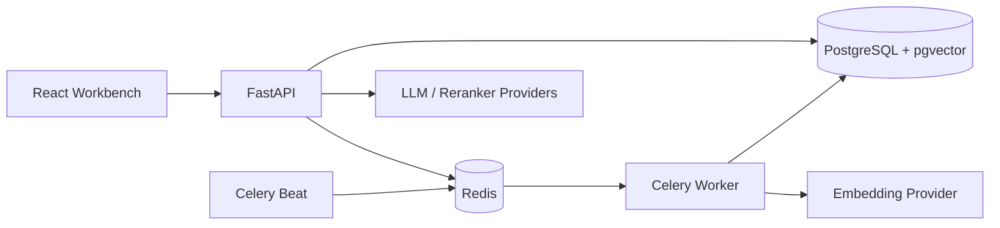
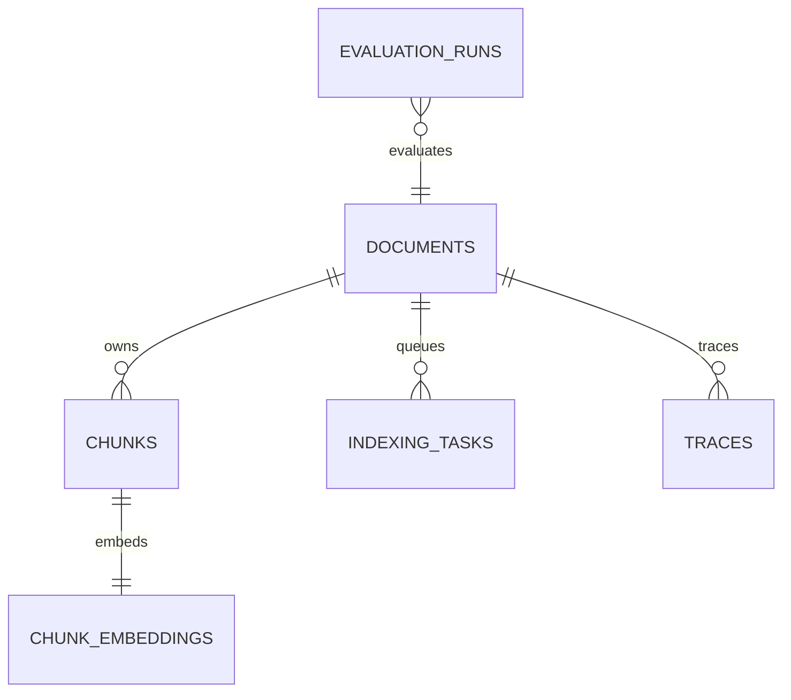
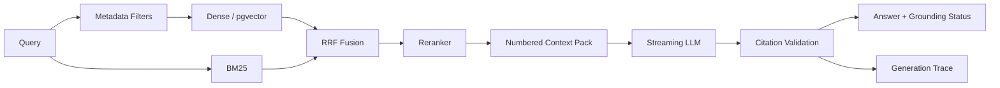

# Architecture Notes

## Runtime Shape

- `app/main.py`: FastAPI app and CORS
- `app/api/routes.py`: HTTP API
- `app/store.py`: `Store` interface and deterministic in-memory adapter
- `app/db/postgres.py`: PostgreSQL adapter for documents, chunks, traces and pgvector embeddings
- `migrations/`: Alembic schema history, including pgvector HNSW index
- `app/dependencies.py`: request-scoped repository access through application state
- `app/services/chunking.py`: fixed, heading and recursive chunkers
- `app/services/retrieval.py`: dense demo, BM25, RRF and heuristic reranking
- `app/services/evaluation.py`: Recall@5, MRR, nDCG@5 and P95 calculation
- `app/workers`: Celery worker and periodic stale-task recovery
- `web/src/pages`: six-page React workbench
- `web/src/lib/api.ts`: typed API boundary

## Demo vs Production

The repository deliberately separates demo implementations from the public contract:

- The default hash embedding responds deterministically without model credentials.
- BGE-M3 and OpenAI-compatible embedding providers are selected through environment configuration.
- Heuristic reranking is local and reproducible.
- The API schemas already contain retrieval ranks, trace stages and citations.
- Documents, chunks, traces and embeddings are persisted through the PostgreSQL adapter.
- Dense retrieval queries stored vectors with pgvector cosine distance.
- Unit tests switch to the in-memory adapter with `STORE_BACKEND=memory`.

## Repository Seam

`app/store.py` defines the `Store` interface used by routes and services. Two adapters satisfy it:

- `InMemoryStore`: seeded deterministic data for unit tests and offline demos
- `PostgresStore`: documents, chunks and traces backed by SQLAlchemy async sessions

Repository contract tests run against both adapters. The PostgreSQL variant is enabled with
`TEST_DATABASE_URL`.

## Retrieval Data Flow

1. Upload or seed creates three chunk profiles and stores all chunks.
2. Embedding vectors are written to `chunk_embeddings`.
3. Dense retrieval sends the query vector to PostgreSQL and orders candidates by `<=>`.
4. Hybrid retrieval reuses the same dense ranking, then applies BM25 and RRF.
5. Trace records whether vectors came from pgvector or a live fallback.

## Schema Changes

Alembic owns the production schema. `PostgresStore` does not create tables at application startup;
the Docker entrypoint runs `alembic upgrade head` before Uvicorn. Repository contract tests use a
dedicated database created by `make test-postgres`.

## Async Indexing Boundary

The HTTP request creates a durable `queued` task and publishes only its ID. The Celery worker owns
the state machine and re-reads the document bytes from PostgreSQL. Celery Beat scans stale processing
tasks and republishes them. Task transitions, cancellation and retries are stored in
`indexing_tasks`; document status is a projection updated in the same database transaction.

## Reranker Boundary

`app/services/reranker.py` defines a small `rerank(query, candidates, top_k)` interface. Adapters
include `none`, heuristic, OpenAI-compatible LLM listwise reranking and local BGE CrossEncoder.
Retrieval records provider name, rank deltas and latency. Provider failures degrade to the
deterministic heuristic and are marked in the Trace.

## Evaluation Dataset Boundary

`data/eval/policy-synthetic-v1.jsonl` contains 152 frozen synthetic cases with a 114/38
development-test split. Test cases are not used for parameter tuning. The benchmark runner records
the dataset, split, provider and fallback count in every report.

## Streaming Boundary

`stream_answer_query` owns the SSE event sequence: `meta → delta* → done | error`. It reuses
`prepare_answer`, so retrieval, Context Pack construction and reranking are identical to the normal
answer API. Citation identifiers are validated before `done`; unknown IDs are returned separately.

## Next Adapter Boundary

M2 has a valid zero-fallback local BGE run on the frozen 38-case test split. M3 now records actual
stream usage, appends a generation stage to Trace, applies grounding guards and stops the producer
when the SSE consumer disconnects. The next boundary is reproducible delivery and CI automation.

## Runtime Diagram

## Document Provenance

Seeded official guides retain `source_name`, `source_url`, `source_retrieved_at` and the source
archive SHA-256. Demo documents leave these fields empty, so the API and workbench can distinguish
synthetic fixtures from official material without relying on title conventions.

## Data Model

## Metadata Filtering

Region, item type, department, official-source and date filters are applied inside the
PostgreSQL chunk queries before candidate material is loaded. The memory adapter uses the same
predicates for contract consistency. Traces include a `metadata_filter` stage with the criteria,
candidate counts and filter latency. Unmatched filters fail explicitly rather than falling back
to another region or source.

## Retrieval and Grounding Flow

## Delivery Automation

GitHub Actions runs four gates: backend checks, frontend checks, PostgreSQL contract tests and
Playwright E2E. The E2E gate requires repository secrets for the real Embedding and LLM providers;
missing credentials fail the job instead of falling back to a mock provider.
